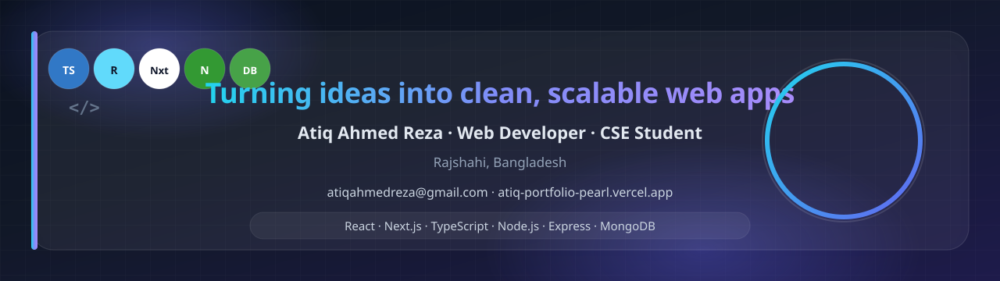

  

<h1 align="center">Hi 👋, I'm Atiq Ahmed Reza</h1>
<h3 align="center">Web Developer · CSE Student · JavaScript Enthusiast</h3>

  👨‍💻 Building modern, responsive, and user-friendly web applications 
  🌱 Exploring AI/ML and intelligent software solutions

  <a href="https://atiq-portfolio-pearl.vercel.app/" target="_blank"><strong>Portfolio</strong></a> ·
  <a href="https://github.com/atiqahmedreza" target="_blank"><strong>GitHub</strong></a>

---

### 👨‍💻 About me

- 👋 Hi, I'm [@atiqahmedreza](https://github.com/atiqahmedreza)
- 📍 Based in **Rajshahi, Bangladesh**
- 🖥️ I work with **React.js**, **Next.js**, **TypeScript**, and modern frontend tooling
- 🗄️ On the backend I use **Node.js**, **Express.js**, and **MongoDB**
- 🚀 Recent projects include [**Fable**](https://github.com/atiqahmedreza/fable-client) (ebook sharing) and [**StudyNook**](https://github.com/atiqahmedreza/studynook-client) (library study room booking)
- 🌱 Currently learning more about **AI/ML**, system design, and production-ready deployments
- 💬 Ask me about **full-stack web development**, **REST APIs**, and **Next.js** apps
- 🌐 Explore my portfolio: [**atiq-portfolio-pearl.vercel.app**](https://atiq-portfolio-pearl.vercel.app/)
- 📫 Reach out via the contact section on my portfolio or open an issue on any of my repos

---

### 🛠️ Tech stack

  

---

### 📊 GitHub stats

  
  

  

---

### 🔥 Featured projects

| Project | Stack | Description |
| --- | --- | --- |
| [**atiq-portfolio**](https://github.com/atiqahmedreza/atiq-portfolio) | Next.js, TypeScript | Personal portfolio with MLOps-focused work |
| [**fable-client**](https://github.com/atiqahmedreza/fable-client) / [**fable-server**](https://github.com/atiqahmedreza/fable-server) | Next.js, Express | Ebook sharing platform (full stack) |
| [**studynook-client**](https://github.com/atiqahmedreza/studynook-client) / [**studynook-server**](https://github.com/atiqahmedreza/studynook-server) | Next.js, Express | Library study room booking system |

---

  

<i>Thanks for stopping by — let's build something useful together.</i>

